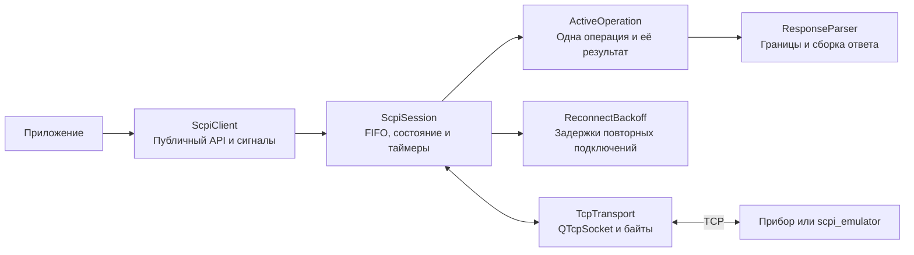
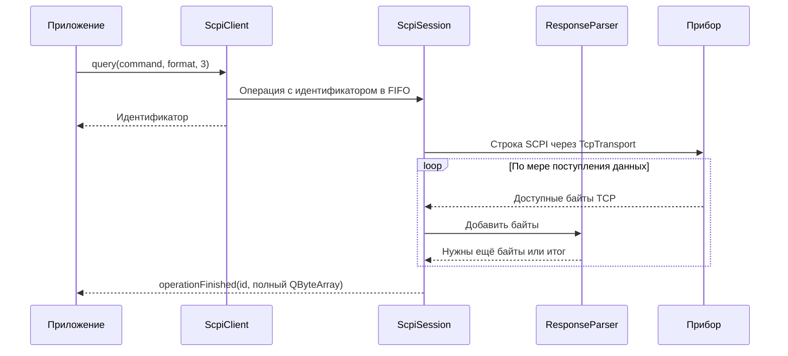
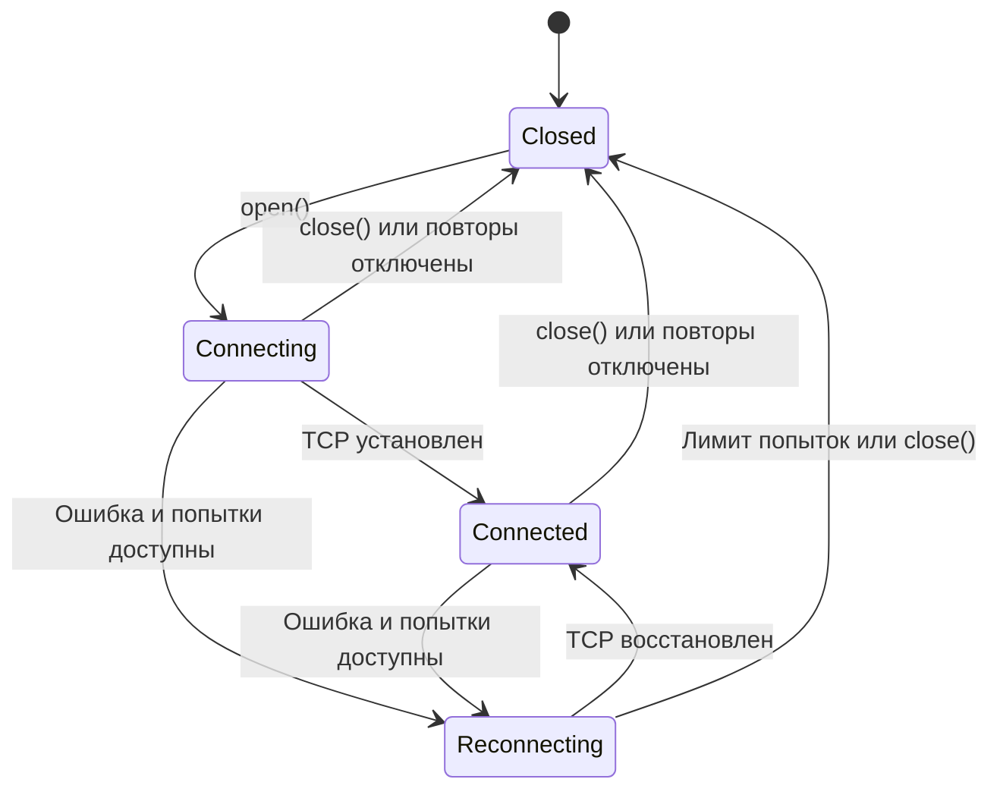

# Устройство драйвера

`ScpiClient` представляет один прибор. Рабочее подключение, временные проверки и все операции экземпляра обслуживаются в одном потоке с циклом событий Qt.

| Компонент | Ответственность |
|---|---|
| `ScpiClient` | Принимает вызовы приложения. Возвращает идентификаторы операций и доставляет сигналы в цикле событий. |
| `ScpiSession` | Координирует рабочее соединение, временные проверки, FIFO и сроки выполнения. Запускает следующую операцию после завершения текущей. |
| `TcpTransport` | Владеет сокетом. Читает байты по `readyRead` и подтверждает локальную запись по `bytesWritten`. |
| `ActiveOperation` | Объединяет запись и ожидание ответа в одну операцию. Проверяет ответ `*OPC?`, когда включено подтверждение. |
| `ResponseParser` | Читает границы текстовых строк и блоков IEEE 488.2. Собирает заданное количество сообщений в один результат с общим пределом размера. |
| `ReconnectBackoff` | Выдаёт ограниченную серию задержек, которые удваиваются до заданного потолка. |

## Жизненный цикл запроса

Один ответ может прийти несколькими чтениями. Одно чтение может содержать несколько полных сообщений и начало следующего. При `query(command, format, count)` итоговый сигнал приходит после `count` сообщений. Для текста драйвер убирает терминаторы и соединяет строки через LF. Для блоков он складывает полезные данные подряд. Превышение общего лимита, повреждённый кадр и неполный ответ по истечении срока завершают операцию типизированной ошибкой.

Для `send(command, false)` достаточно полной локальной записи. `send(command, true)` добавляет отдельную строку `*OPC?` в той же операции. Она завершается после получения полной строки `1` или `+1`. Запрос `query()` всегда ждёт ответ.

## Восстановление

Когда рабочий сокет обрывается или теряет границу ответа, драйвер закрывает его. Активная операция получает причину сбоя, а оставшиеся операции старой очереди получают `SessionLost`. Повторяется только TCP-подключение с созданием нового сокета. Решение о повторной отправке команды принимает приложение с учётом её возможного выполнения прибором.

В состоянии `Reconnecting` вновь вызванные операции ждут нового рабочего сеанса. После исчерпания попыток подключения они получают `SessionLost`. Если первая попытка `open()` не удалась, результат этого вызова ожидает исход всей серии подключения. При успехе он один раз завершится обычным сигналом, при исчерпании попыток получит последнюю ошибку подключения. `close()` завершает ожидающие операции с `Cancelled` и останавливает серию повторов.

Периодический мониторинг использует свободный рабочий сеанс. При полностью закрытом сеансе проверки проходят через короткоживущие подключения. Во время `Connecting` и `Reconnecting` мониторинг пропускает такты, а разовые проверки могут ждать в FIFO. Полная строка с непробельным байтом переводит доступность в `Available`, ошибка начавшейся проверки — в `Unavailable`.
